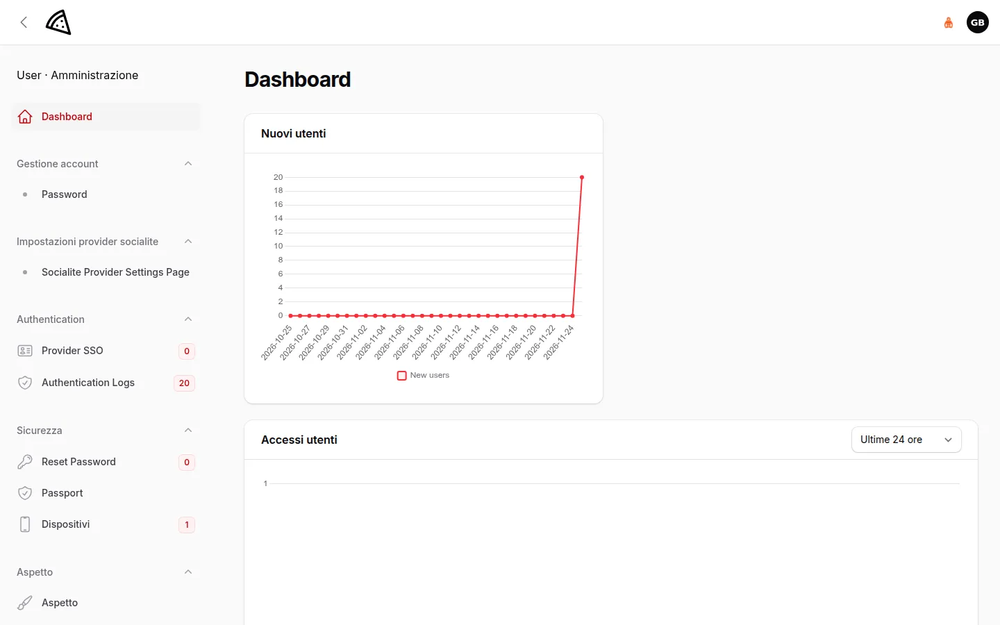

# User

**Identità, autenticazione, autorizzazione, ruoli, team, tenant e OAuth per applicazioni Laravel.**

## Il modulo in breve

User è un pacchetto Laraxot riusabile e agnostico rispetto al prodotto ospitante.
Non contiene regole o contenuti specifici di FixCity: ogni applicazione decide
branding, tenant, ruoli, permessi, provider OAuth e percorso del pannello.

- autenticazione web e API, verifica email e recupero password;
- ruoli e permessi con policy configurabili;
- team, appartenenze e tenant senza imporre un dominio verticale;
- OAuth/Passport/Socialite e gestione dei client;
- log di autenticazione, dispositivi e strumenti per il back office.

## Manuali per ruolo

Le guide sono viste diverse dello stesso contratto del modulo; non assumono che
ogni applicazione esponga tutte le pagine o gli stessi ruoli.

| Figura | Manuale |
| --- | --- |
| Utente finale | [Accesso e profilo](https://github.com/laraxot/module_user_fila5/blob/dev/docs/manuals/manuale-utente-frontoffice.md) |
| Amministratore | [Gestione quotidiana del pannello](https://github.com/laraxot/module_user_fila5/blob/dev/docs/manuals/manuale-admin.md) |
| Super amministratore | [Client OAuth, provider e configurazione](https://github.com/laraxot/module_user_fila5/blob/dev/docs/manuals/manuale-super-admin.md) |
| Operatore / altre figure | [Viste e permessi](https://github.com/laraxot/module_user_fila5/blob/dev/docs/manuals/manuale-altre-figure.md) |
| Riferimento completo pannello | [Manuale utente — `/user/admin`](https://github.com/laraxot/module_user_fila5/blob/dev/docs/manuals/manuale-utente.md) |
| Indice | [Tutti i manuali](https://github.com/laraxot/module_user_fila5/blob/dev/docs/manuals/README.md) |
| Sviluppatore / integratore | [Contratti delle Action](https://github.com/laraxot/module_user_fila5/blob/dev/docs/contracts/README.md) · [ADR](https://github.com/laraxot/module_user_fila5/tree/dev/docs/adr) |

## Link rapidi

- [README del pacchetto](https://github.com/laraxot/module_user_fila5#readme)
- [Documentazione tecnica](https://github.com/laraxot/module_user_fila5/tree/dev/docs)
- [Issue](https://github.com/laraxot/module_user_fila5/issues) · [Pull request](https://github.com/laraxot/module_user_fila5/pulls)
- [Discussions](https://github.com/laraxot/module_user_fila5/discussions) · [Actions](https://github.com/laraxot/module_user_fila5/actions)
- [Milestone](https://github.com/laraxot/module_user_fila5/milestones) · [Label](https://github.com/laraxot/module_user_fila5/labels)
- [Wiki](https://github.com/laraxot/module_user_fila5/wiki) · [Security](https://github.com/laraxot/module_user_fila5/security)

## Contribuire

- Sviluppo sul branch `dev`; nessun branch personale o force-push.
- Collega ogni modifica a una issue e descrivi verifiche e compatibilità.
- Mantieni il dominio nei moduli owner: User fornisce identità e autorizzazione,
  non dati di servizio, workflow o contenuti di un prodotto.
- Usa [CONTRIBUTING.md](./CONTRIBUTING.md) e [SECURITY.md](./SECURITY.md).

## Verifica

I test e l'analisi statica si eseguono nel progetto Laravel host che integra il
modulo; il modulo non presume un'applicazione, un tenant o un database specifici.

_Repository autonomo: [laraxot/module_user_fila5](https://github.com/laraxot/module_user_fila5)._
