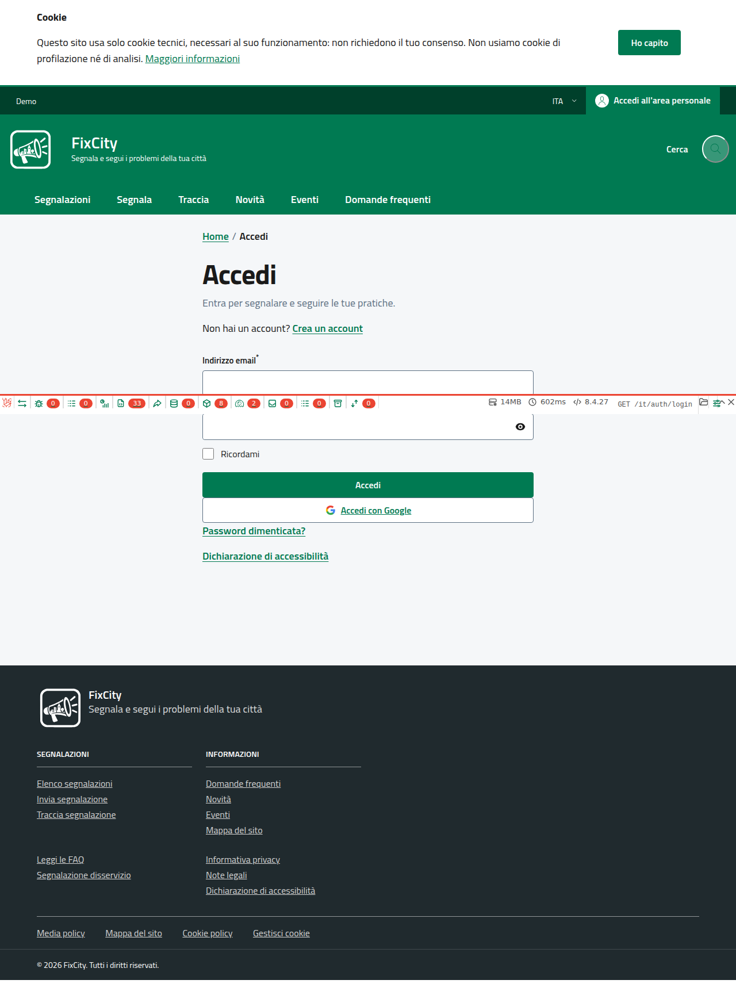

# User

  <strong>Laravel module</strong> 
  <a href="https://github.com/laraxot/module_user_fila5"><code>laraxot/module_user_fila5</code></a>

 
 
 

> Reusable User capabilities for Laravel applications in the Laraxot ecosystem.

User è un pacchetto indipendente e riusabile: non contiene assunzioni su un singolo prodotto, ente o progetto. Il progetto ospitante fornisce configurazione, branding, contenuti e integrazioni specifiche.

## Per iniziare

- [README del repository](https://github.com/laraxot/module_user_fila5)
- [Documentazione](https://github.com/laraxot/module_user_fila5/tree/dev/docs)
- [ADR](https://github.com/laraxot/module_user_fila5/tree/dev/docs/adr) · [Contratti](https://github.com/laraxot/module_user_fila5/tree/dev/docs/contracts)
- [Issue](https://github.com/laraxot/module_user_fila5/issues) · [Discussions](https://github.com/laraxot/module_user_fila5/discussions)

## Manuali

- [manuale utente frontoffice](https://github.com/laraxot/module_user_fila5/blob/dev/docs/manuals/manuale-utente-frontoffice.md)
- [manuale utente](https://github.com/laraxot/module_user_fila5/blob/dev/docs/manuals/manuale-utente.md)
- [manuale admin](https://github.com/laraxot/module_user_fila5/blob/dev/docs/manuals/manuale-admin.md)
- [manuale super admin](https://github.com/laraxot/module_user_fila5/blob/dev/docs/manuals/manuale-super-admin.md)
- [manuale altre figure](https://github.com/laraxot/module_user_fila5/blob/dev/docs/manuals/manuale-altre-figure.md)

## Collaborare

Sviluppo sul branch `dev`; apri una issue riproducibile o una proposta, collega la pull request all'issue e mantieni la documentazione vicino al codice owner. Prima di inviare una modifica esegui i test del progetto ospitante, PHPStan/Pint quando disponibili e il controllo dei link/documenti.

- [Actions](https://github.com/laraxot/module_user_fila5/actions) · [Milestones](https://github.com/laraxot/module_user_fila5/milestones) · [Labels](https://github.com/laraxot/module_user_fila5/labels)
- [Security](https://github.com/laraxot/module_user_fila5/security) per segnalazioni private
- [Wiki](https://github.com/laraxot/module_user_fila5/wiki)

> Le guide descrivono capacità riusabili; URL, ruoli e flussi effettivi possono essere ridefiniti dall'applicazione che installa il pacchetto.
