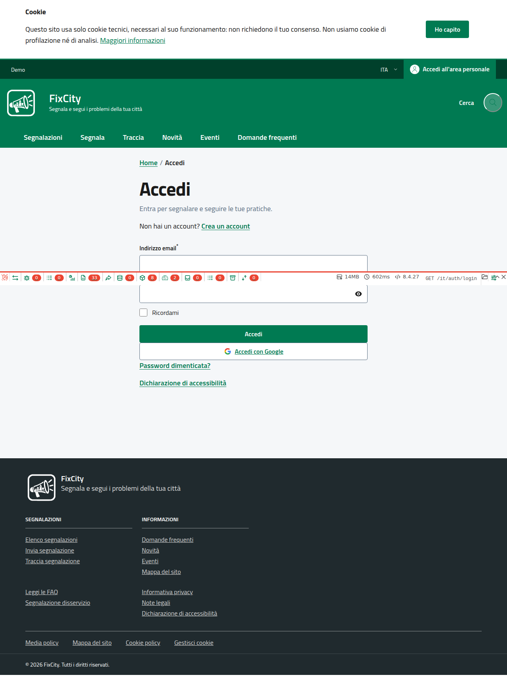

# User — identità, autenticazione e autorizzazione

[](composer.json)
[](../../composer.json)
[](https://filamentphp.com/)
[](LICENSE)
[](https://github.com/laraxot/module_user_fila5/pulls)

<p align="center">
  
</p>

> Modulo Laravel riusabile per gestire identità, autenticazione, ruoli,
> permessi, team, tenant, Passport e Socialite.

User è un pacchetto Composer indipendente. Non contiene concetti di dominio
specifici di un ente, prodotto o progetto: l'applicazione ospitante decide
profili verticali, branding, ruoli applicativi e flussi pubblici.

## Confini

Il modulo risponde a tre domande:

1. **Chi sei?** — account, identità verificata, dispositivi e accessi.
2. **Cosa puoi fare?** — ruoli, permessi, policy e pannello Filament.
3. **Per conto di chi?** — team, tenant e contesto organizzativo.

Non definisce il mestiere, il settore o i dati operativi dell'utente. Un
progetto può estendere `BaseUser` e i contratti del modulo senza modificare il
nucleo riusabile.

## Capacità

- autenticazione web e front office;
- registrazione, verifica email e recupero password;
- login OAuth con Passport e provider Socialite configurati dall'host;
- ruoli e permessi con policy granulari;
- team, inviti e tenant;
- log autenticazione e dispositivi;
- risorse e dashboard Filament per gli amministratori autorizzati.

## Installazione

```bash
composer require laraxot/module_user_fila5
php artisan module:enable User
php artisan migrate
```

Le credenziali OAuth, il dominio applicativo, i provider e i ruoli iniziali
vanno configurati nell'applicazione ospitante. Non copiare configurazioni da
un altro progetto.

## Manuali

- [Manuale utente front office](docs/manuals/manuale-utente-frontoffice.md)
- [Manuale utente](docs/manuals/manuale-utente.md)
- [Manuale admin](docs/manuals/manuale-admin.md)
- [Manuale super admin](docs/manuals/manuale-super-admin.md)
- [Manuale per altre figure](docs/manuals/manuale-altre-figure.md)
- [Contratti delle Action](docs/contracts/README.md)
- [Decisioni architetturali](docs/adr/README.md)

I manuali descrivono capacità generiche. URL, ruoli visibili e integrazioni
effettive dipendono dall'applicazione che installa il modulo.

## Sviluppo e verifica

Dal progetto Laravel host:

```bash
./vendor/bin/phpstan analyse Modules/User
./vendor/bin/pest Modules/User
./vendor/bin/pint --dirty
```

Per una modifica che cambia una promessa di un'Action, aggiorna prima il
contratto corrispondente in `docs/contracts/` e la story owner in
`docs/stories/`.

## Collaborare

Apri una [issue](https://github.com/laraxot/module_user_fila5/issues) con
contesto e riproduzione minima, oppure una
[discussion](https://github.com/laraxot/module_user_fila5/discussions) per una
proposta. Le pull request devono citare l'issue, mantenere il modulo
agnostico e includere la verifica pertinente.

Per segnalazioni riservate usa [Security](https://github.com/laraxot/module_user_fila5/security).
