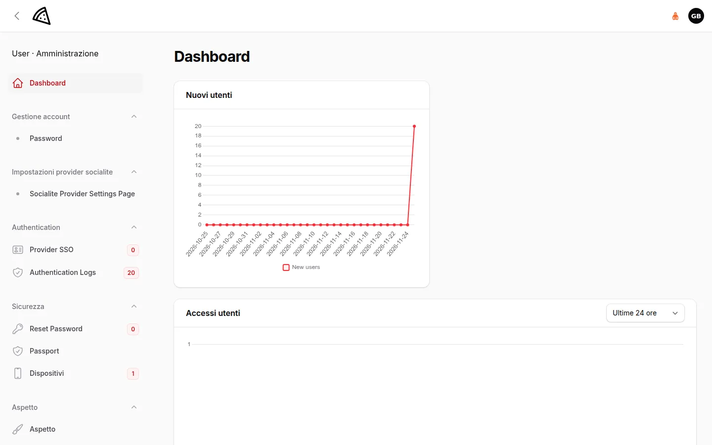
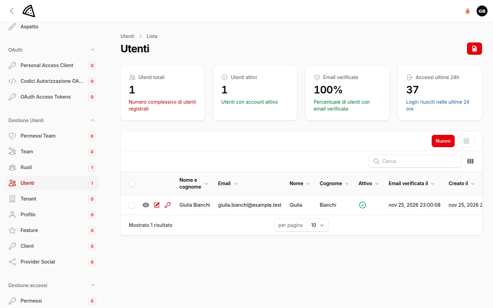
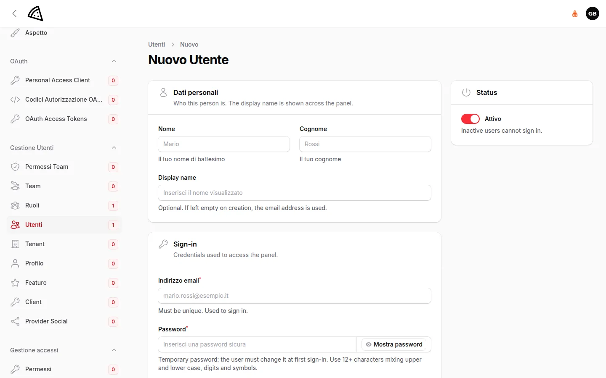
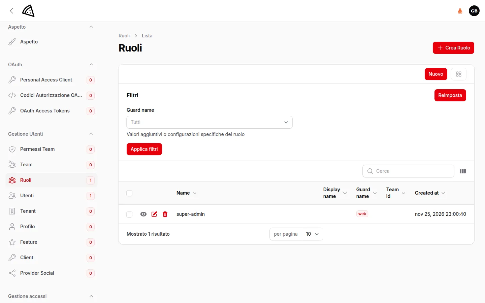
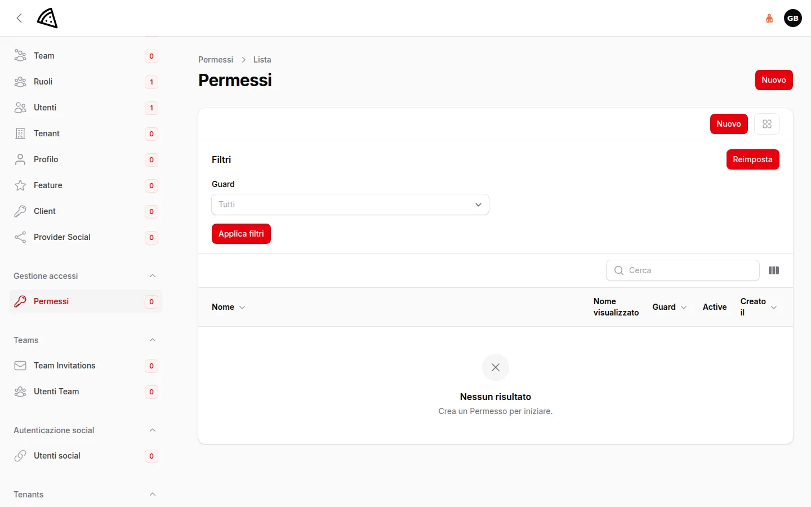
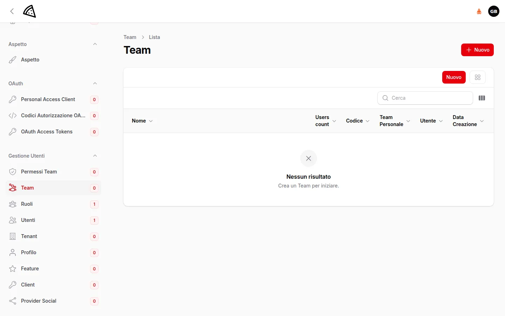
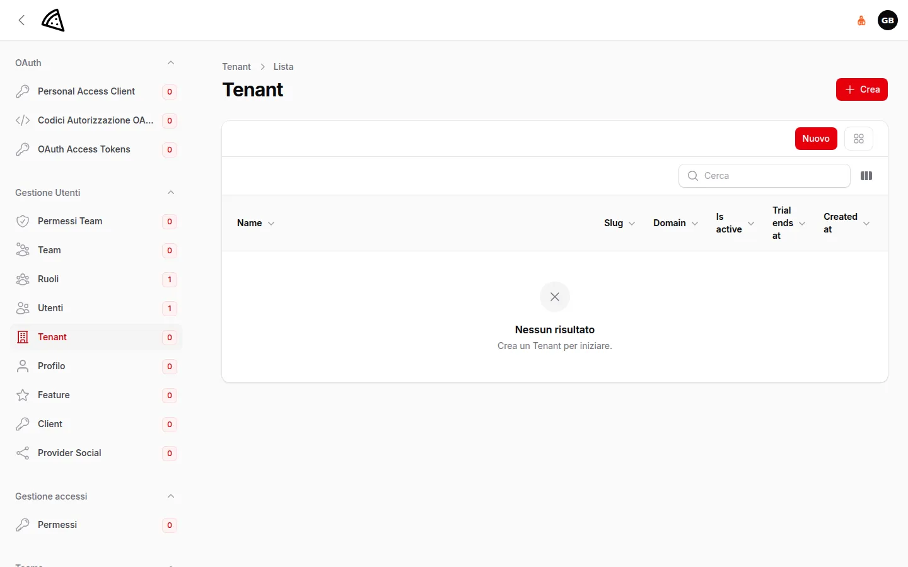
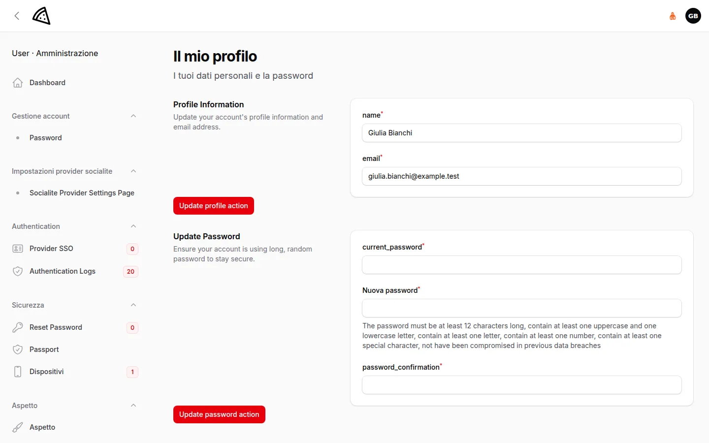
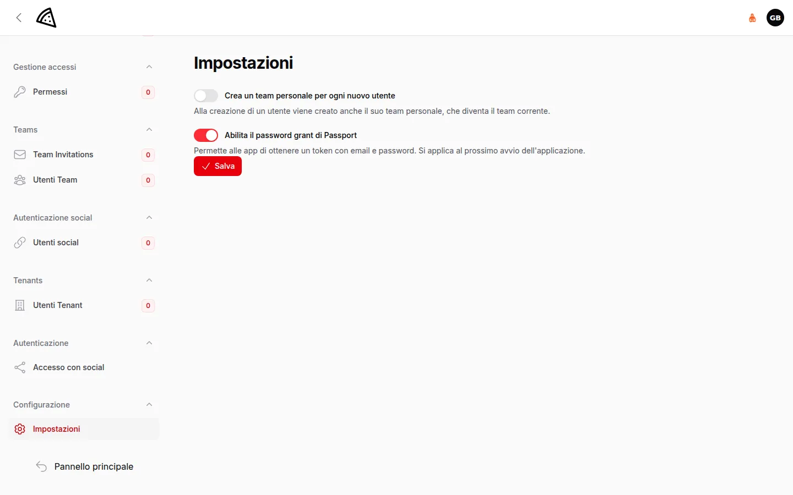

# Manuale admin — modulo User

Guida al **lavoro quotidiano nel pannello** `/user/admin` per
l'amministratore di tenant. Per la descrizione completa di ogni schermata
(campi, colonne, difetti noti) resta il riferimento
[manuale-utente.md](./manuale-utente.md); questo manuale riassume e
organizza per compito. La **configurazione avanzata** (client OAuth,
provider sociali, template mail, allow-list domini, super admin) è nel
[manuale-super-admin.md](./manuale-super-admin.md).

Tutte le immagini sono gli stessi screenshot reali di
`manuale-utente.md` (dati sintetici, `screenshots.json`).

## 1. Accesso

Pagina `/user/admin/login` — vedi
[manuale-utente.md](./manuale-utente.md) sezione «Accesso».

Campi: Email, Password (con **Mostra password**), **Ricordami**, link
**Hai smarrito la password?**, pulsante **Accedi**.

## 2. Dashboard

`/user/admin`. Barra laterale raggruppata in Gestione account,
Impostazioni provider socialite, Authentication, Sicurezza, Aspetto, OAuth,
Gestione Utenti, Teams, Autenticazione social, Tenants, Autenticazione,
Configurazione — con contatori sulle voci.

Widget: **Nuovi utenti** (grafico per giorno) e **Accessi utenti** con
filtro **Ultime 24 ore** (la serie viene da `GetLoginHistoryAction`,
[contratto](../contracts/get-login-history-action.md)).

## 3. Gestione utenti

`/user/admin/users`. Quattro schede riassuntive (utenti totali, attivi,
email verificate, accessi ultime 24h) e tabella con icone per riga.
Creazione: `/user/admin/users/create` — campi Nome, Cognome, Display name,
email (obbligatoria e unica), password temporanea (l'utente deve
cambiarla al primo accesso), interruttore **Attivo**.

Dettaglio completo: [manuale-utente.md](./manuale-utente.md) sezione
«Utenti» e `app/Filament/Resources/UserResource/`.

## 4. Ruoli e permessi

- **Ruoli** — `/user/admin/roles`: lista (Name, Display name, Guard name,
  Team id, Created at), filtro Guard, pulsante **Crea Ruolo**. Nel seed è
  presente `super-admin` (guard `web`).
  
- **Permessi** — `/user/admin/permissions`: Nome, Nome visualizzato, Guard,
  Active, Creato il; filtro Guard.
  

Il modello di autorizzazione è RBAC via Spatie Permission; le sezioni del
pannello compaiono solo se l'utente ha i permessi corrispondenti
(risorse Filament con policy).

## 5. Team e tenant

- **Team** — `/user/admin/teams`: Nome, Users count, Codice, Team
  Personale, Utente, Data Creazione; pulsante **Nuovo**.
  
- **Tenant** — `/user/admin/tenants`: Name, Slug, Domain, Is active,
  Trial ends at, Created at; pulsante **Crea**.
  

Nella prova le liste sono vuote («Nessun risultato»). Risorse correlate in
sidebar: Team Invitations, Utenti Team, Utenti Tenant, Team Permissions.

## 6. Audit e sicurezza quotidiani

- **Authentication Logs** (`AuthenticationLogResource`): registro di ogni
  tentativo di accesso (successo/fallimento, IP, user agent); query
  filtrate via `GetAuthenticationLogQueryAction` /
  `GetAuthenticationLogQueryForAuthenticatableAction`
  ([contratto](../contracts/authentication-log-query-action.md)).
- **Dispositivi** (`DeviceResource`): browser/app registrati dagli utenti;
  `GetCurrentDeviceAction` aggiorna browser e versione a ogni richiesta.
- **Reset Password** (`PasswordResetResource`): token di reset emessi.
- **Profilo personale** — `/user/admin/my-profile-page`: nome, email e
  cambio password con regola forte (≥12 caratteri, maiuscola, minuscola,
  numero, simbolo, non compromessa).
  

## 7. Impostazioni del pannello

`/user/admin/setting` (voce **Impostazioni**, gruppo Configurazione):

- «Crea un team personale per ogni nuovo utente» (nella prova: spento).
- «Abilita il password grant di Passport» (nella prova: acceso; si applica
  al prossimo avvio).

> Le modifiche a client OAuth, provider sociali, template mail di reset,
> allow-list domini e configurazione super admin **non** sono compiti
> quotidiani: vedi [manuale-super-admin.md](./manuale-super-admin.md).

## 8. Impersonation

**Non presente.** Nessuna Action, risorsa o dipendenza di impersonation
(Spatie/Impersonate o simili) è presente nel modulo: non documentare una
funzionalità inesistente.

## Note e difetti noti

Vedi «Difetti noti» in [manuale-utente.md](./manuale-utente.md): alcune
etichette restano in inglese o mostrano chiavi grezze (sezioni del profilo,
intestazioni Team/Tenant/Permessi, menu «Socialite Provider Settings Page»
e «Provider SSO»), e in cima alle liste compare un doppio pulsante «Nuovo»
(comportamento condiviso Xot, non specifico di User).

## Fonti verificabili

- Stessi screenshot e fonti di `manuale-utente.md` (`screenshots.json`,
  `app/Filament/Resources/`, `app/Filament/Pages/MyProfilePage.php`).
- Contratti in `docs/contracts/` per log, dispositivi e query storiche.
