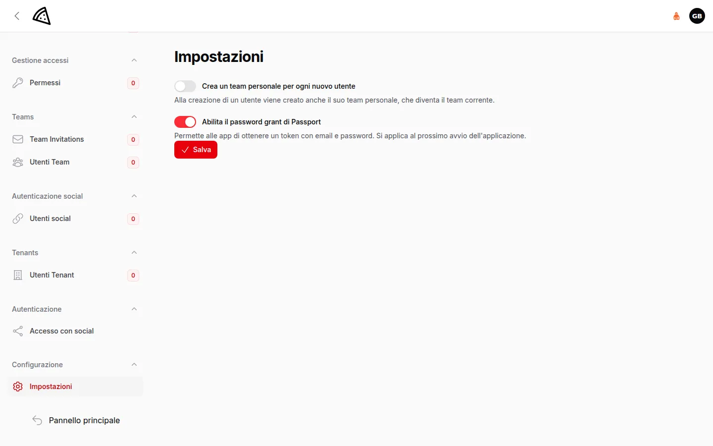

# Manuale super admin — modulo User

Guida alla **configurazione a livello sistema** del modulo User: client
OAuth/Passport, provider sociali, template delle mail, allow-list domini e
impostazioni di sicurezza. Per il lavoro quotidiano sul pannello vedi
[manuale-admin.md](./manuale-admin.md); per la descrizione completa delle
schermate [manuale-utente.md](./manuale-utente.md).

> Super admin qui significa chi ha accesso alle sezioni avanzate del
> pannello `/user/admin` (gruppi OAuth, Sicurezza, Impostazioni provider
> socialite, Authentication). Il modulo espone la configurazione di
> Filament Shield tramite `GetSuperAdminConfigurationAction`
> ([contratto](../contracts/resolve-super-admin-configuration-action.md)):
> `enabled`, `name`, `defined_via_gate`, `gate_interception_status`
> (default: `false`, `'Super Admin'`, `false`, `'block'`). La schermata di
> gestione degli utenti super admin non è in questo manuale perché nessuna
> risorsa dedicata è stata trovata nel perimetro verificato.

## 1. Client OAuth (Passport)

Risorse Filament: `ClientResource`, `OauthClientResource`,
`OauthAccessTokenResource`, `OauthAuthCodeResource`,
`OauthPersonalAccessClientResource`, `OauthRefreshTokenResource`,
`PersonalAccessTokenResource`. Corrispondono ai gruppi **OAuth** e
**Sicurezza > Passport** della sidebar.

Le Action di base (contratti in `docs/contracts/`):

- `CreateClientAction` / `CreateGenericClientAction` /
  `CreatePasswordClientAction` / `CreatePersonalAccessClientAction`:
  creano `oauth_clients` con UUID v4 come id e secret di 40 caratteri;
  `provider` vale `'users'` di default; i flag `personalAccess` e
  `password` passano senza controlli incrociati.
- `RegenerateClientSecretAction`: rigenera il secret.
- `RevokeClientAction`: revoca il client.
- `RevokeTokenAction`, `RevokeRefreshTokenAction`,
  `RevokeAllUserTokensAction`, `RevokeUserAccessAction`: revoca di token
  e accessi.

Password grant: l'interruttore **«Abilita il password grant di Passport»**
nella pagina Impostazioni (`/user/admin/setting`,
`app/Filament/Pages/SettingPage.php`) abilita/disabilita il grant; la
modifica si applica al prossimo avvio dell'applicazione.

## 2. Provider sociali (Socialite)

- **Impostazioni provider socialite** — pagina
  `SocialiteProviderSettingsPage` (menu «Socialite Provider Settings Page»,
  ancora in inglese): consente di configurare i provider OAuth
  (Google, GitHub, ecc.) dalla UI senza toccare `.env`. La configurazione
  viene salvata in `storage/app/private/socialite-config.php` e caricata da
  `SocialiteServiceProvider` al boot; il redirect URI è fornito da
  `GetProviderRedirectUriAction`.
- **Provider SSO** (`SsoProviderResource`) e **Autenticazione social**
  (`SocialProviderResource`, `SocialiteUserResource`) gestiscono i provider
  e gli utenti social collegati.
- Rotte frontoffice: `/{lang}/auth/login/{provider}` con provider
  `google|microsoft|github` (vedi
  [manuale-utente-frontoffice.md](./manuale-utente-frontoffice.md)).

Provider sociali supportati dalle dipendenze (`composer.json`):
`socialiteproviders/auth0` e `socialiteproviders/microsoft`, oltre ai
default Socialite.

## 3. Allow-list domini per il login social

`GetDomainAllowListAction` legge `config('socialite.domain_allowlist')` e
normalizza la lista (stringa → un elemento; elementi non scalari
scartati). Il confronto in `IsUserAllowedAction` è sensibile alle
maiuscole/minuscole e non normalizza spazi: la lista va scritta esattamente
come i domini email. Lista vuota = nessun vincolo (la logica di default
sta in `IsUserAllowedAction`; vedi
[contratto domain-allow-list](../contracts/get-domain-allow-list-action.md)).

## 4. Template mail di reset password

`EnsureResetPasswordMailTemplateAction`
([contratto](../contracts/ensure-reset-password-mail-template-action.md))
garantisce il template `reset-password` (mailable `SpatieEmail`, slug
`reset-password`, layout `base.html`) in tutte le lingue `it`, `en`, `de`,
`es`. Un testo personalizzato **non viene mai sovrascritto**; il sistema
scrive solo se il campo è vuoto o contiene ancora il default legacy.

Il link inserito nella mail è costruito da `BuildPasswordResetUrlAction`
([contratto](../contracts/build-password-reset-url-action.md)):
radice da `config('app.url')` (mai dall'header `Host`, SEC-007), prefisso
di lingua della richiesta, `?email=` opzionale.

> Verificare che `APP_URL` sia l'URL pubblico corretto: un valore sbagliato
> produce link di reset non apribili.

## 5. Altre sezioni di configurazione

Dalla dashboard/sidebar (gruppi e voci verificate in
[manuale-utente.md](./manuale-utente.md)):

- **Impostazioni** (`SettingPage`): team personale automatico, password
  grant Passport.
- **Password** (`Password` page): regole/rotazione password del pannello.
- **Aspetto**, **Feature** (`FeatureResource`) e **Client**
  (`ClientResource`): feature flag e client applicativi.
- **Dispositivi** e **Authentication Logs**: vedi sezione audit in
  [manuale-admin.md](./manuale-admin.md).

## 6. Sicurezza — note operative

- Le API login hanno rate limiting via `build-api-login-limit-action`;
  sul pannello web il login è Filament standard.
- Tutti i token OAuth/Passport emessi sono elencati e revocabili dalle
  risorse OAuth: audit periodico consigliato su `OauthAccessTokenResource`
  e `PersonalAccessTokenResource`.
- Gli eventi di autenticazione sono in `AuthenticationLogResource`
  (solo lettura per l'audit; l'Action di registrazione è
  `RecordAuthenticationLogAction`).

## Fonti verificabili

- Contratti: `resolve-super-admin-configuration-action.md`,
  `create-client-action.md`, `create-generic-client-action.md`,
  `create-password-client-action.md`,
  `create-personal-access-client-action.md`,
  `regenerate-client-secret-action.md`, `revoke-*-action.md`,
  `ensure-reset-password-mail-template-action.md`,
  `get-domain-allow-list-action.md`,
  `build-password-reset-url-action.md` in `docs/contracts/`.
- Codice: `app/Filament/Pages/SocialiteProviderSettingsPage.php`,
  `app/Filament/Pages/SettingPage.php`, `app/Providers/SocialiteServiceProvider.php`,
  `app/Providers/PassportServiceProvider.php`, `app/Filament/Resources/`.
